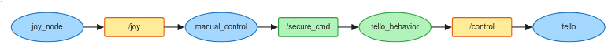
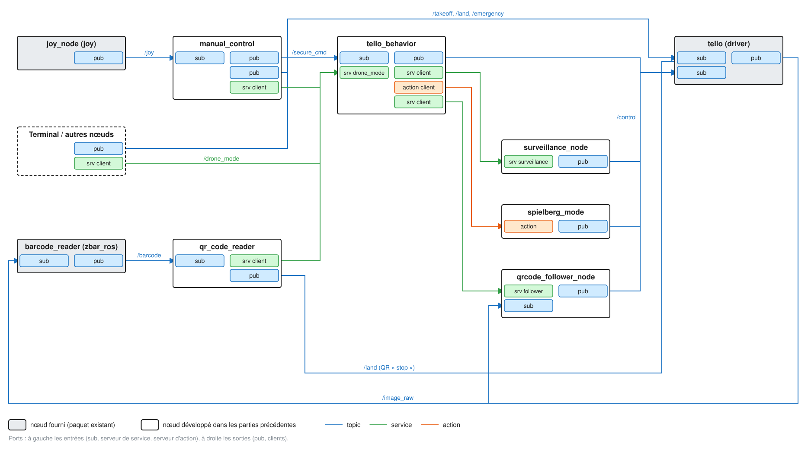
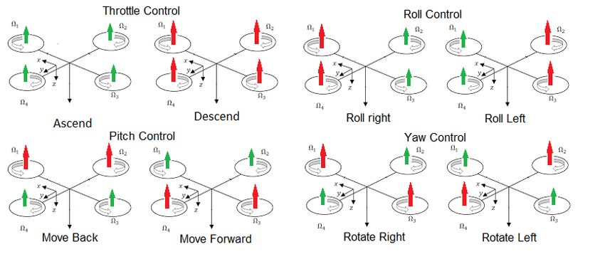

# Projet Tello

## 1. Objectifs du TP

L'objectif de ce TP est de mettre en place plusieurs scénarios de contrôle pour un drone Tello EDU à l'aide de ROS 2. Le projet permet de piloter le drone manuellement avec une manette connectée au PC, mais également de déclencher des comportements automatiques.

Les différents modes prévus sont :

- Mode manuel : contrôle du déplacement du drone à l'aide d'une manette.
- Mode cinéma (« Spielberg ») : exécution d'un mouvement prédéfini à la lecture d'un QR code.
- Mode surveillance : rotation continue du drone sur lui-même.
- Mode follower : suivi des mouvements d'un QR code.

L'architecture repose sur plusieurs nœuds ROS 2 qui communiquent entre eux à l'aide de topics, de services et d'actions.

## 2. Architecture du projet

### 2.1. Présentation des noeuds

Le projet utilise le driver du drone ainsi que plusieurs noeuds développés pour gérer les commandes et les comportements.

| Noeud | Rôle |
|---|---|
|`tello`| Établit la communication avec le drone via Wi-Fi et expose ses commandes et ses données sous forme de topics ROS 2. |
|`joy_node`| Récupère les informations de la manette connectée au PC et les publie sur le topic /joy. |
|`manual_control`| nterprète les axes et les boutons de la manette pour commander le déplacement du drone, gérer le décollage et l'atterrissage, déclencher l'arrêt d'urgence et changer de mode.|
|`tello_behavior`| Gère les différents modes de fonctionnement et coordonne les comportements automatiques. Il sert notamment de point de passage pour les commandes de déplacement.
|`survellance_node`| Fournit le comportement de  surveillance, qui consiste à faire tourner le drone sur lui-même.|
|`spielberg`| Fournit un comportement prédéfini au drone puis reviens au mode par défaut. |

### 2.2. Communication entre les noeuds 

Le nœud joy_node publie les informations de la manette sur /joy. Le nœud manual_control s'y abonne pour interpréter les commandes de l'utilisateur.

Les commandes de déplacement suivent ensuite le chemin suivant :



Le topic /secure_cmd permet de distinguer les commandes de déplacement avant filtrage de celles transmises au driver. Le nœud tello_behavior peut ainsi contrôler ces commandes avant leur exécution.

Les commandes de décollage (/takeoff), d'atterrissage (/land) et d'arrêt d'urgence (/emergency) restent indépendantes de ce filtrage des déplacements.

Pour les comportements automatiques, tello_behavior communique avec les serveurs correspondants afin de déclencher les actions demandées. Le comportement de surveillance est fourni par surveillance_node, tandis que spielberg permet d'exécuter une séquence de mouvement prédéfinie.

Le changement de mode est réalisé à l'aide du service /drone_mode, qui reçoit un numéro de mode et permet de demander au nœud tello_behavior le comportement souhaité.



### 2.3. Modes de fonctionnement

Les mides sont identifiés par un numéro transmis au service **/drone_mode** :

| Valeur | Mode | Comportement |
|---|---|---|
| 0 | Manuel | Le drone est contrôle directement à la manette. |
| 1 | Surveillance | Le drone tourne continuellement sur lui-même. |
| 2 | Spielberg | Le drone exécute un mouvement prédéfini. |
| 3 | Follower | Le drone tourne continuellement sur lui-même. |

État d'avancement : les modes manuel, Spielberg et surveillance constituent les comportements actuellement mis en place. Le déclenchement des comportements par lecture d'un QR code et le mode follower restent à développer.

## 3. Installation et préparation

Les commandes suivantes sont à exécuter depuis le workspace ROS 2 du projet.

### 3.1. Compiler le projet

Après avoir récupéré le dépôt et installé les dépendances nécessaires :

``` bash
cd ~/tello_ws/src/tello-ros2
source .venv/bin/activate
cd ~/tello_ws
source install/setup.bash
```

Compiler les packages :

``` bash
cd ~/tello_ws/
colcon build --symlink-install (--packages-select <pkg>)
source install/setup.bash
```
Le workspace doit être compilé à nouveau lorsque des modifications nécessitent une recompilation.

### 3.2. Vérifier la manette

Avant de piloter le drone, il est nécessaire de vérifier que la manette est bien détectée par le PC.

Lancer le nœud de la manette :

`ros2 run joy joy_node`

Dans un autre terminal, après avoir sourcé le workspace, afficher les informations reçues :

`ros2 topic echo /joy`

Le message contient notamment :

- axes : les valeurs des joysticks et des gâchettes ;
- buttons : l'état des différents boutons.

Les indices des axes et des boutons peuvent varier selon le modèle de manette et sa configuration. Il faut donc tester chaque bouton et chaque joystick, puis adapter les constantes correspondantes dans manual_control.

Il est également possible de vérifier que le topic existe avec :

`ros2 topic list`

## 4. Lancement du projet

Chaque commande doit être exécutée dans un terminal distinct. Dans chaque nouveau terminal, sourcer le workspace avant d'exécuter les commandes ROS 2 :

``` bash
cd ~/tello_ws/src/tello-ros2
source .venv/bin/activate
cd ~/tello_ws
source install/setup.bash
```

### 4.1. Connexion au drone

Connecter le PC au réseau Wi-Fi du drone Tello EDU, puis lancer le driver :

`ros2 run tello tello`

Ce nœud établit la communication avec le drone et permet aux autres nœuds ROS 2 de lui transmettre des commandes.

### 4.2. Lancement des nœuds de contrôle

Dans trois terminaux distincts, lancer les commandes suivantes :

`ros2 run joy joy_node`

`ros2 run control_drone manual_control`

`ros2 run control_drone tello_behavior`

Ces trois nœuds permettent respectivement de récupérer les informations de la manette, d'interpréter les commandes de l'utilisateur et de gérer les différents modes de fonctionnement du drone.

### 4.3. Lancement des comportements automatiques

Pour rendre les comportements automatiques disponibles, lancer également les serveurs correspondants dans deux terminaux distincts :

`ros2 run control_drone surveillance_node`

`ros2 run control_drone spielberg`

Le nœud surveillance_node fournit le comportement de surveillance, qui consiste à faire tourner le drone sur lui-même. Le serveur d'action spielberg permet quant à lui de déclencher un mouvement prédéfini.

### 4.4. Changer de mode

Le changement de mode peut être effectué de deux manières : depuis le terminal à l'aide du service /drone_mode, ou directement depuis la manette grâce aux boutons associés dans manual_control.

Par exemple, pour sélectionner le mode manuel depuis le terminal :

`ros2 service call /drone_mode pkg_msg/srv/DroneMode "{mode: 0}"`

Les modes disponibles sont identifiés par un numéro :

- 0 : mode manuel ;
- 1 : mode surveillance;
- 2 : mode Spielberg ;
- 3 : mode follower.

Depuis la manette, il suffit d'appuyer sur le bouton associé au mode souhaité. Le nœud manual_control envoie alors une requête au service /drone_mode, qui transmet le changement au nœud tello_behavior.

Le mode follower et le déclenchement des comportements par lecture d'un QR code restent à implémenter.

## 5. Questions

## Question 1 :

Les quatre commandes classiques d'un drone quadrirotor sont :

    - Throttle : cette commande permet de faire monter ou descendre le drone en modifiant la vitesse des quatre hélices simultanément. En augmentant leur vitesse, la poussée augmente et le drone monte. En la diminuant, le drone descend.

    - Roll : cette commande fait tourner le drone autour de l'axe x. Elle est réalisée en augmentant la vitesse des hélices d'un côté du drone et en diminuant celle des hélices du côté opposé. Par exemple, en augmentant la vitesse des hélices de droite et en diminuant celle des hélices de gauche, le drone s'incline vers la gauche, et inversement.

    - Pitch : cette commande est similaire à la précédente, mais elle fait tourner le drone autour de l'axe y. Elle est réalisée en modifiant la vitesse des hélices avant et arrière afin d'incliner le drone vers l'avant ou vers l'arrière.

    - Yaw : cette commande fait tourner le drone autour de l'axe z, c'est-à-dire sur lui-même. Elle est obtenue en modifiant les vitesses des hélices qui tournent dans les deux sens de rotation opposés, afin de créer un couple qui fait pivoter le drone à droite ou à gauche.



Avec ces quatre commandes, on peut déplacer le drone dans différentes directions et contrôler sa trajectoire dans l'espace.

Throttle permet de contrôler la hauteur du drone. En augmentant la poussée des quatre hélices, le drone monte, tandis qu'en la diminuant, il descend.

Roll permet de se déplacer à gauche ou à droite. Pour cela, le drone s'incline sur le côté et une composante de la poussée est alors dirigée vers le côté souhaité.

Pitch fonctionne de manière similaire au Roll, mais permet cette fois de se déplacer vers l'avant ou vers l'arrière en inclinant le drone dans cette direction.

Yaw permet de faire tourner le drone autour de son axe vertical, donc de l'orienter vers la gauche ou vers la droite.

En combinant plusieurs commandes, on peut réaliser des trajectoires plus complexes. Par exemple, en combinant Pitch + Yaw, le drone peut avancer tout en tournant. Avec Throttle + Pitch, il peut avancer tout en montant. Enfin, avec Pitch + Roll, il peut se déplacer en diagonale.

Ainsi, en faisant varier et en combinant les quatre commandes au cours du temps, il est possible de contrôler précisément la position et l'orientation du drone afin de lui faire suivre une trajectoire donnée.

## Question 2 :

- Parmi les trois packages, tello utilise ament_python, tandis que tello_control et tello_msg utilisent ament_cmake.

La différence est dans la manière dont le code est construit et installé :

    - ament_python : le code Python est installé directement dans le dossier install/ et les exécutables sont définis dans setup.py.

    - ament_cmake : la construction et l'installation sont gérées par CMake à l'aide de CMakeLists.txt. Cela permet notamment de compiler du code ou de générer des interfaces ROS 2 comme dans tello_msg.

Dans les deux cas, le résultat est installé dans le dossier install/ et peut ensuite être utilisé par ROS 2.

- Dans les commandes `ros2 run tello tello` et `ros2 run tello_control tello_control`, le deuxième argument correspond au nom de l'exécutable.

    - Pour tello, ce nom est défini dans le fichier `setup.py`, dans la section `console_scripts`, dans `entry_points`. Il associe le nom de l'exécutable à une fonction Python.

    - Pour tello_control, le nom est défini dans le CMakeLists.txt, avec la commande `add_executable()`.

Le nom de l'exécutable ne correspond donc pas forcément au nom du fichier source. Il s'agit d'un nom choisi lors de la configuration du package et sous lequel ROS 2 installe et lance le programme.

## Question 3

Il est préférable d'installer colcon dans le venv afin qu'il utilise le même interpréteur Python que celui du venv.

Colcon génère les exécutables utilisés par ros2 run avec l'interpréteur Python qui l'exécute. Si on utilise le colcon installé sur le système, les exécutables peuvent être associés au Python système plutôt qu'à celui du venv.

Installer colcon dans le venv garantit donc que les exécutables générés utilisent le bon environnement Python et ses dépendances, ce qui évite des problèmes de compatibilité lors de l'exécution.

## Question 4

Les topics correspondant aux commandes du drone sont :

| Topic | Type de message | Description |
|---|---|---|
| `/control` | `geometry_msgs/msg/Twist` | Permet de contrôler les mouvements du drone (déplacement et rotation). |
| `/takeoff` | `std_msgs/msg/Empty` | Commande de décollage. |
| `/land` | `std_msgs/msg/Empty` | Commande d'atterrissage. |
| `/emergency` | `std_msgs/msg/Empty` | Commande d'arrêt d'urgence. |
| `/flip` | `std_msgs/msg/String` | Commande permettant de réaliser un flip. |

Les topics /parameter_events et /rosout ne correspondent pas aux commandes du drone. Ils sont utilisés par ROS 2 pour la gestion des paramètres et des messages de log.

## Question 5

Le retour vidéo du drone a été visualisé à l'aide de deux outils différents : rqt et RViz. Ces deux méthodes permettent d'afficher les images transmises par le topic de la caméra et de vérifier que le flux vidéo est correctement reçu.

**Affichage du retour avec rqt :**  


**Affichage du retour avec RViz :**  


## Question 6

La mesure du capteur de distance ToF a été visualisée à l'aide d'un plugin rqt. Pour observer l'évolution de la mesure, le drone a été déplacé verticalement à la main, moteurs éteints, afin de faire varier la distance entre le capteur et le sol.

Le graphique ci-dessous permet ainsi d'observer les variations de la distance mesurée en fonction de la hauteur du drone.


## Question 7

Pour réaliser ce changement, nous avons modifié le nœud manual_control afin qu'il publie les commandes de déplacement sur le topic /secure_cmd au lieu de /control. Le nœud tello_behavior.py s'abonne à ce topic, filtre les commandes de déplacement, puis les transmet au driver du drone via le topic /control.

Ce filtrage concerne uniquement les commandes de déplacement et de rotation du drone. Les commandes telles que le décollage (/takeoff), l'atterrissage (/land) et l'arrêt d'urgence (/emergency) restent directement accessibles et fonctionnelles.

L'intérêt est de pouvoir contrôler les mouvements du drone avant leur exécution, sans bloquer les commandes essentielles à son fonctionnement et à sa sécurité.

Il est préférable d'effectuer ce changement en sortie de manual_control, au niveau des commandes issues de joy, afin de séparer les commandes de déplacement de l'utilisateur des commandes autorisées à atteindre le drone. Cela permet également de conserver le driver indépendant de la logique de filtrage et d'éviter une boucle de communication en distinguant les topics d'entrée et de sortie.


# TP 

## Commande utile

Commande d'arrêt d'urgence :
    - ros2 topic pub --once /emergency std_msgs/msg/Empty "{}"

Commande de décollage :
    - ros2 topic pub --once /takeoff std_msgs/msg/Empty "{}"

Commande d'atterrissage :
    - ros2 topic pub --once /land std_msgs/msg/Empty "{}"

## Commande pour lancer le projet

ros2 run tello tello

ros2 run joy joy_node

ros2 run control_drone manual_control

ros2 run control_drone tello_behavior

ros2 run control_drone surveillance_node

ros2 run control_drone spielberg

ros2 service call /drone_mode pkg_msg/srv/DroneMode "{mode: 0}"


