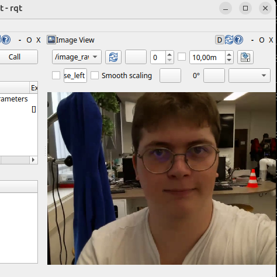
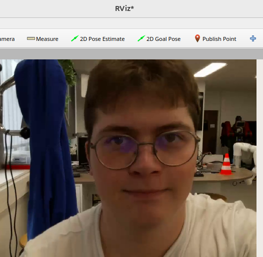
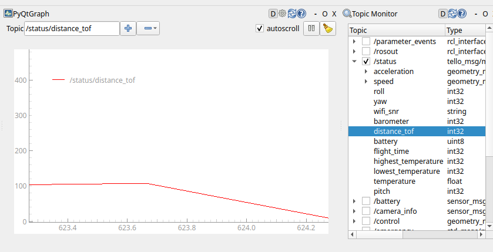

# Projet Tello

## Objectifs

Dans ce projet, nous allons prendre en main ROS2 en utilisant les plateformes Tello-EDU.

## Mission

Mettre en place différents scénarios sur les drones Tello-EDU :

    - contrôle manuel via une manette connectée au PC
    - déclenchement de comportements spécifiques à la lecture d'un QR code

Les comportements (modes) à mettre en place :

    - mode manuel : vous contrôlez le drone à la manette
    - mode follower : le drone suit les mouvements d'un QR code
    - mode cinéma (« Spielberg ») : le drone déclenche un mouvement automatique à la lecture d'un QR code
    - mode surveillance : le drone tourne sur lui-même en continu

# Introduction

## Question 1 :

Les quatre commandes classiques d'un drone quadrirotor sont :

    - Throttle : cette commande permet de faire monter ou descendre le drone en modifiant la vitesse des quatre hélices simultanément. En augmentant leur vitesse, la poussée augmente et le drone monte. En la diminuant, le drone descend.

    - Roll : cette commande fait tourner le drone autour de l'axe x. Elle est réalisée en augmentant la vitesse des hélices d'un côté du drone et en diminuant celle des hélices du côté opposé. Par exemple, en augmentant la vitesse des hélices de droite et en diminuant celle des hélices de gauche, le drone s'incline vers la gauche, et inversement.

    - Pitch : cette commande est similaire à la précédente, mais elle fait tourner le drone autour de l'axe y. Elle est réalisée en modifiant la vitesse des hélices avant et arrière afin d'incliner le drone vers l'avant ou vers l'arrière.

    - Yaw : cette commande fait tourner le drone autour de l'axe z, c'est-à-dire sur lui-même. Elle est obtenue en modifiant les vitesses des hélices qui tournent dans les deux sens de rotation opposés, afin de créer un couple qui fait pivoter le drone à droite ou à gauche.

Avec ces quatre commandes, on peut déplacer le drone dans différentes directions et contrôler sa trajectoire dans l'espace.

Throttle permet de contrôler la hauteur du drone. En augmentant la poussée des quatre hélices, le drone monte, tandis qu'en la diminuant, il descend.

Roll permet de se déplacer à gauche ou à droite. Pour cela, le drone s'incline sur le côté et une composante de la poussée est alors dirigée vers le côté souhaité.

Pitch fonctionne de manière similaire au Roll, mais permet cette fois de se déplacer vers l'avant ou vers l'arrière en inclinant le drone dans cette direction.

Yaw permet de faire tourner le drone autour de son axe vertical, donc de l'orienter vers la gauche ou vers la droite.

En combinant plusieurs commandes, on peut réaliser des trajectoires plus complexes. Par exemple, en combinant Pitch + Yaw, le drone peut avancer tout en tournant. Avec Throttle + Pitch, il peut avancer tout en montant. Enfin, avec Pitch + Roll, il peut se déplacer en diagonale.

Ainsi, en faisant varier et en combinant les quatre commandes au cours du temps, il est possible de contrôler précisément la position et l'orientation du drone afin de lui faire suivre une trajectoire donnée.

# Preparation de l'environnement

## Question 2 :

- Parmi les trois packages, tello utilise ament_python, tandis que tello_control et tello_msg utilisent ament_cmake.

La différence est dans la manière dont le code est construit et installé :

ament_python : le code Python est installé directement dans le dossier install/ et les exécutables sont définis dans setup.py.

ament_cmake : la construction et l'installation sont gérées par CMake à l'aide de CMakeLists.txt. Cela permet notamment de compiler du code ou de générer des interfaces ROS 2 comme dans tello_msg.

Dans les deux cas, le résultat est installé dans le dossier install/ et peut ensuite être utilisé par ROS 2.

- Dans les commandes `ros2 run tello tello` et `ros2 run tello_control tello_control`, le deuxième argument correspond au nom de l'exécutable.

    - Pour tello, ce nom est défini dans le fichier `setup.py`, dans la section `console_scripts`, dans `entry_points`. Il associe le nom de l'exécutable à une fonction Python.

    - Pour tello_control, le nom est défini dans le CMakeLists.txt, avec la commande `add_executable()`.

Le nom de l'exécutable ne correspond donc pas forcément au nom du fichier source. Il s'agit d'un nom choisi lors de la configuration du package et sous lequel ROS 2 installe et lance le programme.

## Question 3

Il est préférable d'installer colcon dans le venv afin qu'il utilise le même interpréteur Python que celui du venv.

Colcon génère les exécutables utilisés par ros2 run avec l'interpréteur Python qui l'exécute. Si on utilise le colcon installé sur le système, les exécutables peuvent être associés au Python système plutôt qu'à celui du venv.

Installer colcon dans le venv garantit donc que les exécutables générés utilisent le bon environnement Python et ses dépendances, ce qui évite des problèmes de compatibilité lors de l'exécution.

## Question 4

Les topics correspondant aux commandes du drone sont :

/control → geometry_msgs/msg/Twist : permet de contrôler les mouvements du drone (déplacement et rotation).

/takeoff → std_msgs/msg/Empty : commande de décollage.

/land → std_msgs/msg/Empty : commande d'atterrissage.

/emergency → std_msgs/msg/Empty : commande d'arrêt d'urgence.

/flip → std_msgs/msg/String : commande permettant de réaliser un flip.

Les topics /parameter_events et /rosout ne correspondent pas aux commandes du drone. Ils sont utilisés par ROS 2 pour la gestion des paramètres et des messages de log.

# Mise en route du drone

## Question 5

## Question 6

# Contrôle du drone

## Commande utile

Commande d'arrêt d'urgence :
    - ros2 topic pub --once /emergency std_msgs/msg/Empty "{}"

Commande de décollage :
    - ros2 topic pub --once /takeoff std_msgs/msg/Empty "{}"

Commande d'atterrissage :
    - ros2 topic pub --once /land std_msgs/msg/Empty "{}"

Décollage 9 : A / 3 
    - buttons [0,0,1,0,0,0,0,0,0,0,0,0,0,0,0,0]
Arrêt d'urgence 8: B / 2 
    - buttons [0,1,0,0,0,0,0,0,0,0,0,0,0,0,0,0]
Atterrissage 7 : X / 1 
    - buttons [1,0,0,0,0,0,0,0,0,0,0,0,0,0,0,0]
Déplacements du drone joysticks 3 et 12 :
    - joystick 3:
        - devant:
            - axes [0,1,0,0,0,0,0]
        - derrière:
            - axes [0,-1,0,0,0,0,0]
        - gauche:
            - axes [1,0,1,0,0,0,0]
        - droite:
            - axes [-1,0,-1,0,0,0,0]
    - joystick 12:
        - devant:
            - axes [0,0,1,0,1,0,0]
        - derrière:
            - axes [0,0,-1,0,-1,0,0]
        - gauche:
            - axes [0,0,0,1,0,0,0]
        - droite:
            - axes [0,0,0,-1,0,0,0]

## Question 7

Pour faire ce filtrage, on a rajouter un publisher et un subscriver intermediaire dans tello_behavior.py, son subscriver va recuperer le /secure_cmd et son publisher va envoyer a Tello_driver /control. L'utilité est de separer le nom du topic apres et avant filtre si on ne le fais pas on se retrouverais dans une boucle.

# Commande pour lancer le projet

ros2 run tello tello

ros2 run joy joy_node

ros2 run control_drone manual_control

ros2 run control_drone tello_behavior

ros2 run control_drone surveillance_node

ros2 run control_drone spielberg

ros2 service call /drone_mode pkg_msg/srv/DroneMode "{mode: 0}"

